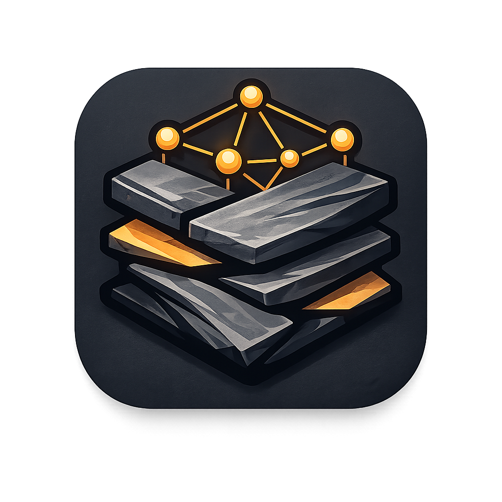

# ShaleDB

<div align="center">
  
  <p>
    <a href="https://github.com/ryszardzmija/shaledb/actions/workflows/ci.yaml">
      
    </a>
  </p>
</div>

ShaleDB is an embedded, persistent key-value storage engine. It stores binary keys and values on local disk and supports reads, writes, and deletes on individual keys. The project prioritizes correctness and durability, with a simple architecture that makes it easier to reason about what happens when a write succeeds or is interrupted.

The engine draws on Bitcask's append-only storage model. Segment files hold the history of writes and deletes. A global in-memory key directory points to the latest record for each live key, so the engine can read it directly.

ShaleDB syncs each write or delete before reporting success. On startup, it validates and replays the log to rebuild the key directory and can discard an incomplete record left at the end of the active segment. Durability depends on the filesystem and storage device honoring the required syncs.

## Getting started

### Prerequisites

Use JDK 25 and Bazel 9.1.0. Bazelisk can select the pinned version. Building the gRPC server or running the full test suite also requires a host C++ toolchain to build the Protocol Buffers compiler. CI runs on Ubuntu. Keep the database on a local filesystem that supports exclusive file locks and file and directory syncs.

### Building

Build the embedded library and gRPC server from the repository root.

```bash
bazel build //storage:storage //server:server
```

### Running

To embed ShaleDB in a Java application in this workspace, add `//storage:storage` to your target's `deps`. Open a `KeyValueStore` on an existing directory.

```java
import com.ryszardzmija.shaledb.storage.KeyValueStore;
import com.ryszardzmija.shaledb.storage.config.StorageConfig;
import com.ryszardzmija.shaledb.storage.durability.DurabilityMode;

import java.io.IOException;
import java.nio.file.Files;
import java.nio.file.Path;

import static java.nio.charset.StandardCharsets.UTF_8;

void main() throws IOException {
    var directory = Files.createDirectories(Path.of("data/embedded"));
    var config = new StorageConfig(65_536, 16_384, directory, DurabilityMode.SYNC_EACH_WRITE);
    var key = "greeting".getBytes(UTF_8);

    try (var store = new KeyValueStore(config)) {
        store.put(key, "Hello".getBytes(UTF_8));
        System.out.println(new String(store.get(key).orElseThrow(), UTF_8));
        store.delete(key);
    }
}
```

For network access to the same engine, start the included server from the repository root. It listens for plaintext gRPC on port `50001` and loads its default settings from [config/application.yaml](config/application.yaml).

```bash
bazel run //server:server
```

## Testing

The storage suite checks engine behavior with real files and uses fault injection to exercise recovery and error handling. The full suite also covers server configuration and gRPC integration.

```bash
bazel test //storage:storage_tests
bazel test //:tests
```

## Documentation

For the storage contract, recovery assumptions, and configuration, see the [architecture guide](docs/README.md).

## Project status

The project is still under active development. We plan to add log compaction so ShaleDB can reclaim disk space from obsolete records, and concurrent access so applications can use the same store from multiple threads.

## License

ShaleDB is distributed under the [MIT License](LICENSE).
