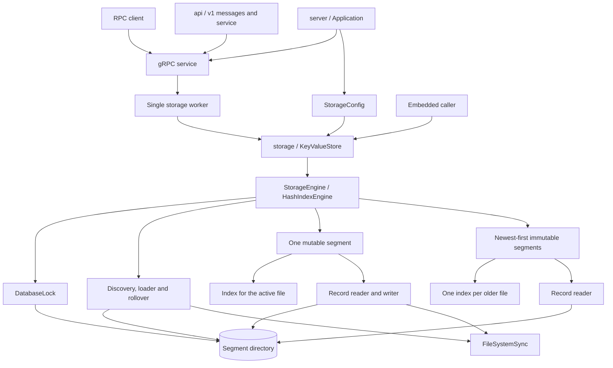
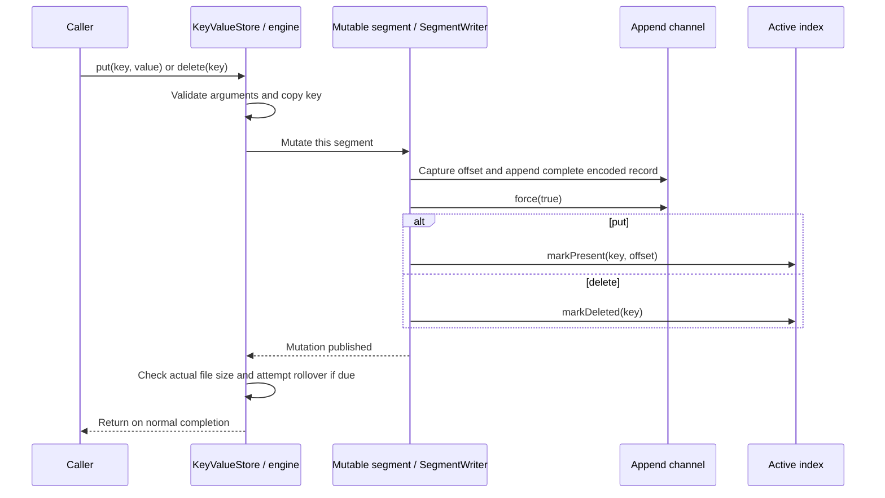
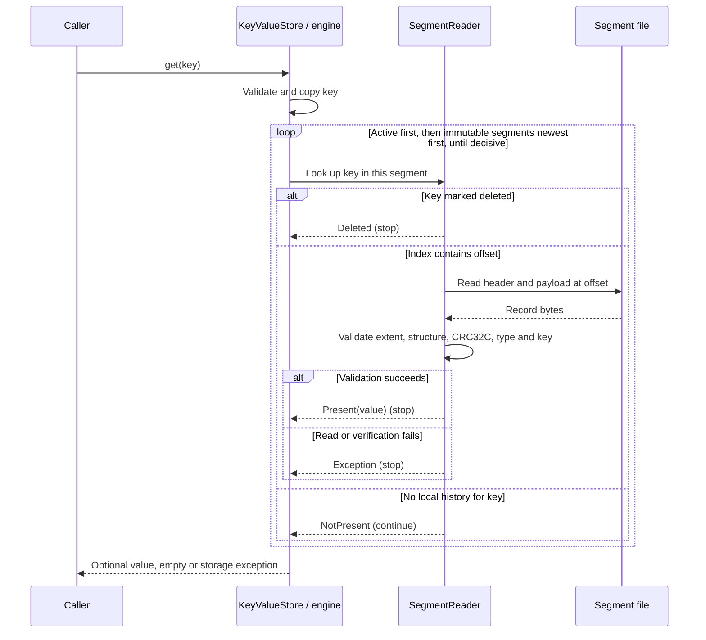

# Architecture

ShaleDB implements single-key point reads, overwrites and deletes. A Java program can open a directory through `KeyValueStore`. The server exposes those operations through three unary RPCs. The unit of persistence is a record appended to a segment file. The unit of lookup is a binary key. There is no transaction grouping, range iteration, replication or persistent index in this implementation. This scope keeps both the protocol and the startup algorithm small. [Project overview](../README.md) · [StorageEngine](../storage/src/main/java/com/ryszardzmija/shaledb/storage/StorageEngine.java) · [key_value_store.proto](../api/src/main/proto/shaledb/key_value_store.proto)

## Components and ownership

| Boundary | State and responsibilities |
| --- | --- |
| `api` | Proto3 schema, generated Java messages, stubs and service base. The wire contract has no notion of a segment or file offset. [API build](../api/BUILD.bazel) |
| `server` | `Application` owns configuration loading, directory preparation, store, executor and gRPC process lifecycle. Its service adapts messages, observer callbacks and exceptions to Java calls. [Application](../server/src/main/java/com/ryszardzmija/shaledb/server/Application.java) |
| `storage` public surface | `KeyValueStore` owns a `StorageEngine`, forwards synchronous operations, logs and rethrows engine exceptions and supports try-with-resources. Its constructor always selects `HashIndexEngine`. [KeyValueStore](../storage/src/main/java/com/ryszardzmija/shaledb/storage/KeyValueStore.java) |
| `storage.config` and `durability` | Map required settings to immutable records. `FileSystemSync` performs the file and directory force calls. The installed policy is sync on each write. [StorageConfigMapper](../storage/src/main/java/com/ryszardzmija/shaledb/storage/config/StorageConfigMapper.java) · [FileSystemSync](../storage/src/main/java/com/ryszardzmija/shaledb/storage/durability/FileSystemSync.java) |
| `hash` and `hash.segment` | The engine owns the active segment, the newest-first history list and exclusive directory ownership. `files` selects and creates names, `loader` opens the layout, `model` owns channels and indexes, and `rollover` prepares replacements. The ownership object keeps channels that remain open after cleanup reachable. [HashIndexEngine](../storage/src/main/java/com/ryszardzmija/shaledb/storage/hash/HashIndexEngine.java) · [DatabaseLock](../storage/src/main/java/com/ryszardzmija/shaledb/storage/hash/DatabaseLock.java) · [SegmentLoader](../storage/src/main/java/com/ryszardzmija/shaledb/storage/hash/segment/loader/SegmentLoader.java) · [RolloverHandler](../storage/src/main/java/com/ryszardzmija/shaledb/storage/hash/segment/rollover/RolloverHandler.java) |
| `hash.index` | An owned copy of the key plus an offset or deletion marker is retained per segment. Indexes exist only in memory and can be reconstructed from records. [HashIndex](../storage/src/main/java/com/ryszardzmija/shaledb/storage/hash/index/HashIndex.java) · [IndexBuilder](../storage/src/main/java/com/ryszardzmija/shaledb/storage/hash/index/IndexBuilder.java) |
| `serialization` | `record` represents binary payloads and types. `spec` defines field widths, byte order and type codes. `io` turns records into channel writes and validates positional reads. [RecordWriter](../storage/src/main/java/com/ryszardzmija/shaledb/storage/serialization/io/RecordWriter.java) · [RecordReader](../storage/src/main/java/com/ryszardzmija/shaledb/storage/serialization/io/RecordReader.java) |

At build time `server_lib` depends on both `//api:api` and `//storage:storage`. Storage links to the logging stack and uses JDK file APIs. It can operate without generated messages, Jackson, Netty or a running server. The segment directory holds the durable history. The engine infers the active segment from filenames on every open. [Server build](../server/BUILD.bazel) · [Storage build](../storage/BUILD.bazel) · [Segment management](segment-management.md)

## Opening a store

The constructor derives the segment and durability settings and acquires exclusive ownership of the configured directory. Under that lock it discovers and validates the layout in one directory scan. The greatest numeric ID determines the active segment and seeds the factory's allocation counter. When the layout is empty, the factory creates and synchronizes the first file. The loader opens older segments newest first and the active segment last, building a fresh index for each file. The engine enters `OPEN` after installing the complete layout. Failed initialization cleans up under ownership. [Concurrency and lifecycle](concurrency-and-lifecycle.md) · [Segment management](segment-management.md) · [Indexing](indexing.md)

## Put and delete

Both mutations append even when the logical state already matches the request. The order of append, force and publication is explicit. The size check and possible index rebuild during rollover are also on the caller's path. A failure there reaches the caller with the triggering mutation's force already completed. [Storage semantics](storage-semantics.md) · [Durability and recovery](durability-and-recovery.md)

## Get

Only an absent local entry permits the search to continue. A deletion marker terminates the search with absence, and a failed present read terminates it with a storage exception. [Indexing](indexing.md)

## Design decisions and trade-offs

- **Preserve the storage boundary.** A synchronous engine and a separate wire adapter allow the same implementation to serve both entry points. Serialization of RPC work is a server decision. The embedded caller must supply its own access discipline. [Concurrency and lifecycle](concurrency-and-lifecycle.md)
- **Preserve reconstructible state.** Writing one record and rebuilding the derived index avoids having to atomically update separate data and index files. The costs are full replay at open, an index per segment and an ever-growing history. This trade-off is an architectural inference. [Indexing](indexing.md)
- **Preserve explicit durability ordering.** The comment in `SegmentWriter.put` identifies correctness as the rationale for per-write force and acknowledges the throughput cost. This ordering gives a well-defined point to publish to readers. It leaves an uncertainty window when the storage stack reports failure. [SegmentWriter](../storage/src/main/java/com/ryszardzmija/shaledb/storage/hash/segment/model/SegmentWriter.java)
- **Scoped resource ownership.** Segment constructors open channels and replay data before returning their segment. Load and rollover own their provisional segments until returning them to the engine. The engine retains responsibility for cleanup of any segment channel still open after a close error. [Concurrency and lifecycle](concurrency-and-lifecycle.md) · [Testing](testing.md)
- **Segment extent and rollover policy.** Lookup and replay use the actual file extent and the payload read budget. The configured segment size triggers rollover after mutation and can change independently of which historical offsets are readable. [Segment management](segment-management.md) · [Configuration](configuration.md)
