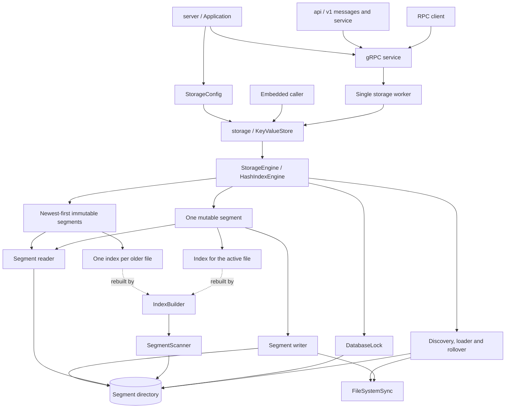
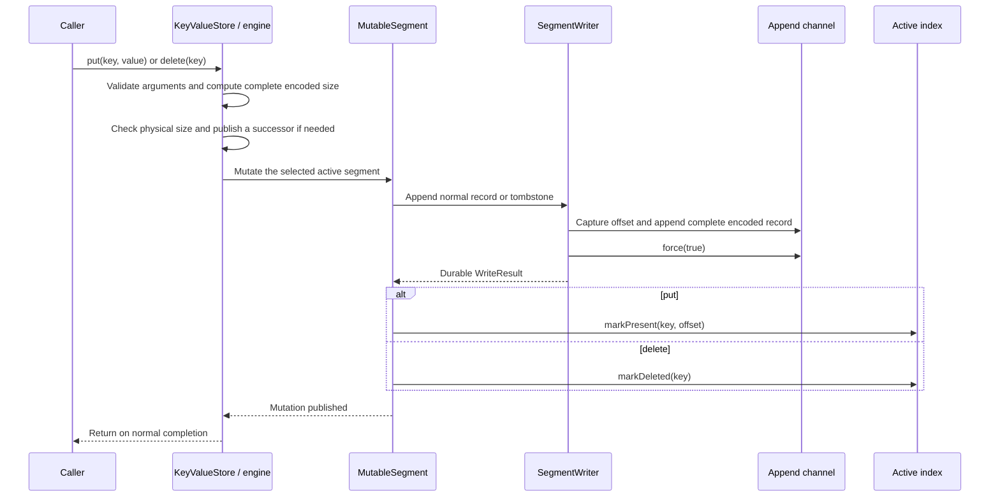
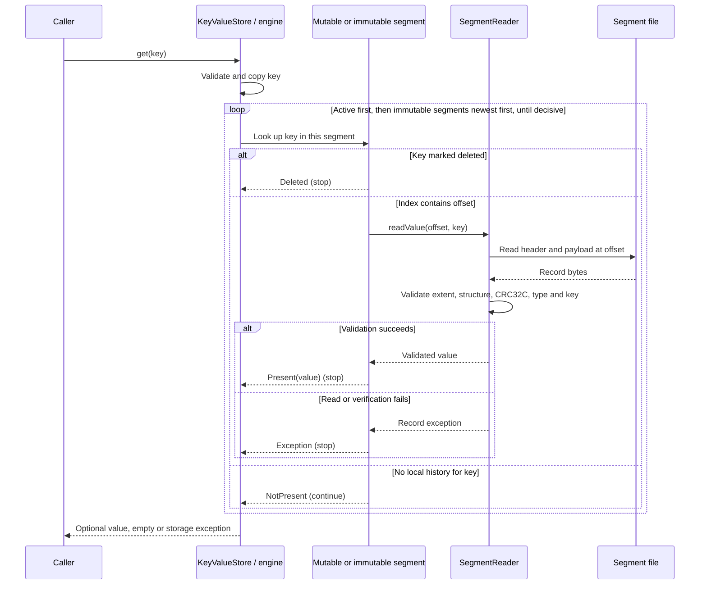

# Architecture

ShaleDB implements a Bitcask-inspired design for single-key reads, overwrites and deletes. Segment files hold the persistent history. Each open segment has an in-memory hash index derived from its records. Embedded applications call the engine directly. The gRPC server uses the same engine on behalf of remote clients. [Storage semantics](storage-semantics.md)

| Module | Responsibility |
| --- | --- |
| `api` | Proto3 schema, generated Java messages, stubs and service base. The wire contract has no notion of a segment or file offset. [API build](../api/BUILD.bazel) |
| `server` | `Application` owns configuration loading, directory preparation, store, executor and gRPC process lifecycle. Its service adapts messages, observer callbacks and exceptions to Java calls. [Application](../server/src/main/java/com/ryszardzmija/shaledb/server/Application.java) |
| `storage` public surface | `KeyValueStore` owns a `StorageEngine`, forwards synchronous operations, logs and rethrows engine exceptions and supports try-with-resources. Its constructor always selects `HashIndexEngine`. [KeyValueStore](../storage/src/main/java/com/ryszardzmija/shaledb/storage/KeyValueStore.java) |
| `storage.config` and `durability` | Map required settings to immutable records. `FileSystemSync` performs the file and directory force calls. The installed policy is sync on each write. [StorageConfigMapper](../storage/src/main/java/com/ryszardzmija/shaledb/storage/config/StorageConfigMapper.java) · [FileSystemSync](../storage/src/main/java/com/ryszardzmija/shaledb/storage/durability/FileSystemSync.java) |
| `hash` and `hash.segment` | The engine owns the active segment, the newest-first history list and exclusive directory ownership. `files` selects and creates names, `loader` opens the layout, `model` owns channels and indexes, and `rollover` prepares replacements. The ownership object keeps channels that remain open after cleanup reachable. [HashIndexEngine](../storage/src/main/java/com/ryszardzmija/shaledb/storage/hash/HashIndexEngine.java) · [DatabaseLock](../storage/src/main/java/com/ryszardzmija/shaledb/storage/hash/DatabaseLock.java) · [SegmentLoader](../storage/src/main/java/com/ryszardzmija/shaledb/storage/hash/segment/loader/SegmentLoader.java) · [RolloverHandler](../storage/src/main/java/com/ryszardzmija/shaledb/storage/hash/segment/rollover/RolloverHandler.java) |
| `hash.index` | An owned copy of the key plus an offset or deletion marker is retained per segment. Indexes exist only in memory and can be reconstructed from records. [HashIndex](../storage/src/main/java/com/ryszardzmija/shaledb/storage/hash/index/HashIndex.java) · [IndexBuilder](../storage/src/main/java/com/ryszardzmija/shaledb/storage/hash/index/IndexBuilder.java) |
| `serialization` | `record` represents binary payloads and types. `spec` defines field widths, byte order and type codes. `io` encodes and validates records. `SegmentScanner` delivers validated records and offsets to a replay consumer. [RecordWriter](../storage/src/main/java/com/ryszardzmija/shaledb/storage/serialization/io/RecordWriter.java) · [RecordReader](../storage/src/main/java/com/ryszardzmija/shaledb/storage/serialization/io/RecordReader.java) · [SegmentScanner](../storage/src/main/java/com/ryszardzmija/shaledb/storage/serialization/io/SegmentScanner.java) |

At build time `server_lib` depends on both `//api:api` and `//storage:storage`. Storage links to the logging stack and uses JDK file APIs. It can operate without generated messages, Jackson, Netty or a running server. The segment directory holds the durable history. The engine infers the active segment from filenames on every open. [Server build](../server/BUILD.bazel) · [Storage build](../storage/BUILD.bazel) · [Segment management](segment-management.md)

## Opening a store

## Read and write paths

On open, the engine acquires exclusive directory ownership, discovers segments by numeric ID and rebuilds an index for each file. The highest ID is the **active segment** (mutable). All lower IDs are **historical segments** (immutable). Embedded callers must serialize operations, including close. [Concurrency and lifecycle](concurrency-and-lifecycle.md)

Both mutations append even when the logical state already matches the request. The guarded path begins with the size query and includes any rollover, then append, force and index publication. The engine can continue after deterministic ID exhaustion. An ambiguous storage or handoff failure disables normal operations before control returns to the caller. [Fail-stop policy](storage-semantics.md#fail-stop-policy) · [Durability and recovery](durability-and-recovery.md)

## Get

## Design costs

Keeping indexes reconstructible avoids a second persistent structure that would have to commit atomically with each record. The costs are a scan of the entire history at startup, retained keys in each segment's index, and potentially one index probe per segment on lookup. Without compaction, obsolete values and tombstones continue to occupy disk space and historical files stay open.

- **Preserve the storage boundary.** A synchronous engine and a separate wire adapter allow the same implementation to serve both entry points. Serialization of RPC work is a server decision. The embedded caller must supply its own access discipline. [Concurrency and lifecycle](concurrency-and-lifecycle.md)
- **Preserve reconstructible state.** Writing one record and rebuilding the derived index avoids having to atomically update separate data and index files. The costs are full replay at open, an index per segment and an ever-growing history. This trade-off is an architectural inference. [Indexing](indexing.md)
- **Preserve explicit durability ordering.** `SegmentWriter` returns the append result after the required force. `MutableSegment` then publishes the local index change. A reported force failure leaves the persistence outcome uncertain. [SegmentWriter](../storage/src/main/java/com/ryszardzmija/shaledb/storage/hash/segment/model/SegmentWriter.java) · [MutableSegment](../storage/src/main/java/com/ryszardzmija/shaledb/storage/hash/segment/model/MutableSegment.java)
- **Scoped resource ownership.** Segment constructors open channels and replay data before returning their segment. Load and rollover own their provisional segments until returning them to the engine. The engine retains responsibility for cleanup of any segment channel still open after a close error. [Concurrency and lifecycle](concurrency-and-lifecycle.md) · [Testing](testing.md)
- **Segment extent and rollover policy.** Lookup and replay use the actual file extent and the payload read budget. The configured segment size limits new appends. Valid historical offsets remain readable beyond that threshold. [Segment management](segment-management.md) · [Configuration](configuration.md)
