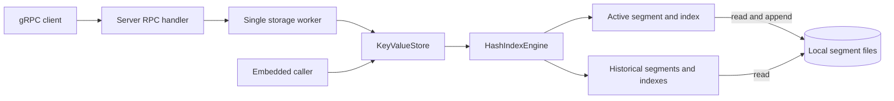

# Architecture

ShaleDB implements a Bitcask-inspired design for single-key reads, overwrites and deletes. Segment files hold the persistent history. Each open segment has an in-memory hash index derived from its records. Embedded applications call the engine directly. The gRPC server uses the same engine on behalf of remote clients. [Storage semantics](storage-semantics.md)

| Module | Responsibility |
| --- | --- |
| `api` | Defines the `shaledb.v1.KeyValueStore` protobuf service and generates its Java messages and gRPC bindings. File layout and engine diagnostics are private to storage. [Service definition](../api/src/main/proto/shaledb/key_value_store.proto) |
| `storage` | Exposes the closeable `KeyValueStore` façade. Its `HashIndexEngine` owns the directory lock, segments and indexes, and implements validation, persistence and recovery using local files. An embedded application can use it independently of the server. [KeyValueStore](../storage/src/main/java/com/ryszardzmija/shaledb/storage/KeyValueStore.java) · [HashIndexEngine](../storage/src/main/java/com/ryszardzmija/shaledb/storage/hash/HashIndexEngine.java) |
| `server` | Loads configuration, opens one store and adapts unary RPCs to serialized engine calls. It owns request scheduling, response delivery and process shutdown. [Server architecture](server-architecture.md) |

## Read and write paths

On open, the engine acquires exclusive directory ownership, discovers segments by numeric ID and rebuilds an index for each file. The highest ID is the **active segment** (mutable). All lower IDs are **historical segments** (immutable). Embedded callers must serialize operations, including close. [Concurrency and lifecycle](concurrency-and-lifecycle.md)

A mutation validates its input, selects a segment with room for the whole encoded record, then appends a normal record or a tombstone at EOF. After a successful file force, it publishes the new offset or deletion marker in the active index and returns. The previous records stay on disk. [Segment management](segment-management.md) · [Durability and recovery](durability-and-recovery.md)

A lookup probes the active index and then the historical indexes in descending ID order. The first entry decides the result. A present entry leads to a validated read at its offset. A deletion marker masks older values. A miss across all indexes requires no record I/O. [Indexing](indexing.md)

## Design costs

Keeping indexes reconstructible avoids a second persistent structure that would have to commit atomically with each record. The costs are a scan of the entire history at startup, retained keys in each segment's index, and potentially one index probe per segment on lookup. Without compaction, obsolete values and tombstones continue to occupy disk space and historical files stay open.

Each successful mutation pays for synchronous persistence. Operations apply to one key at a time. The engine offers no multi-key transactions, snapshots or range scans. Its recovery rule relies on a single serialized writer and immutable history. [Durability and recovery](durability-and-recovery.md)
