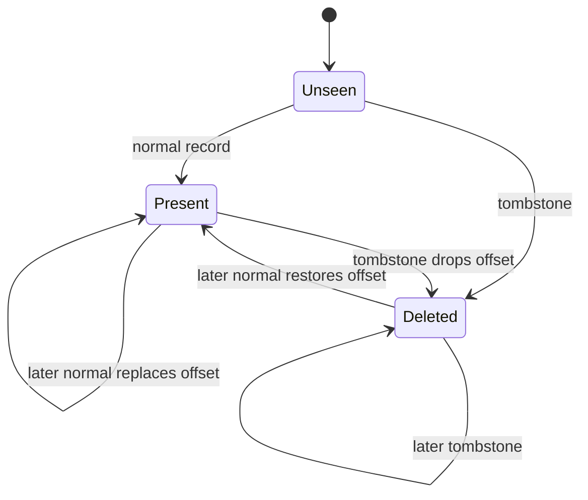

# Indexing

Each open segment owns one in-memory `Index`. Its offsets are meaningful only in that file. The active segment shares the same index between its reader and writer. An older segment builds an index on open and subsequently exposes only reads. The engine supplies recency ordering across files. [Index](../storage/src/main/java/com/ryszardzmija/shaledb/storage/hash/index/Index.java) · [MutableSegment](../storage/src/main/java/com/ryszardzmija/shaledb/storage/hash/segment/model/MutableSegment.java) · [ImmutableSegment](../storage/src/main/java/com/ryszardzmija/shaledb/storage/hash/segment/model/ImmutableSegment.java)

## Local key state

`ByteKey` owns a copy of its input and returns a copy from `getData()`. It hashes the complete byte sequence with `Arrays.hashCode` and compares it with `Arrays.equals`. Equal binary keys have equal hashes, and equality resolves collisions between distinct keys. `matches` compares decoded bytes directly with the owned copy. [ByteKey](../storage/src/main/java/com/ryszardzmija/shaledb/storage/hash/index/ByteKey.java)

`HashIndex` uses a `HashMap<ByteKey, Long>` for present keys and a `HashSet<ByteKey>` for deletions. Missing from both means no local record. `markPresent` checks that the offset is nonnegative, puts the offset and removes the deletion marker. `markDeleted` adds the marker and removes the offset. The two container changes form a single logical transition only under serialized access. [HashIndex](../storage/src/main/java/com/ryszardzmija/shaledb/storage/hash/index/HashIndex.java)



The index API exposes separate `isDeleted` and `getKeyOffset` calls. `SegmentReader.get` checks the marker first and returns `Deleted` without rereading the tombstone. Successful mutation or validated replay establishes that marker. An empty offset after the marker check yields `NotPresent`. A present entry reads and verifies the complete record on each lookup. [SegmentReader](../storage/src/main/java/com/ryszardzmija/shaledb/storage/hash/segment/model/SegmentReader.java) · [LookupResult](../storage/src/main/java/com/ryszardzmija/shaledb/storage/hash/segment/model/LookupResult.java)

## Live maintenance and replay

In a live segment, put publishes the writer's append start only after successful append and force. Delete publishes a marker at that same stage and discards its write result. On rebuild, `IndexBuilder` always starts at zero and uses the following loop. There is no saved index, checkpoint or persisted list of keys. [SegmentWriter](../storage/src/main/java/com/ryszardzmija/shaledb/storage/hash/segment/model/SegmentWriter.java) · [IndexBuilder](../storage/src/main/java/com/ryszardzmija/shaledb/storage/hash/index/IndexBuilder.java)

```text
while offset < readChannel.size():
    record = reader.read(offset)          # validates header, payload and CRC
    key = owned copy of record.key
    if record.type == TOMBSTONE: index.markDeleted(key)
    else:                        index.markPresent(key, offset)
    offset = record.nextRecordOffset
```

The reader computes each next offset from the positive encoded size after checking that the complete record fits in the file. Replay follows these boundaries in append order, including overwritten records. The same sequence of successful puts and deletes therefore yields the same states and present offsets during replay and live maintenance. [RecordReader](../storage/src/main/java/com/ryszardzmija/shaledb/storage/serialization/io/RecordReader.java) · [IndexBuilder](../storage/src/main/java/com/ryszardzmija/shaledb/storage/hash/index/IndexBuilder.java)

The engine probes the mutable index, then immutable indexes from highest ID to lowest. Only `NotPresent` continues the search. A newer `Deleted` result shadows all older versions, and a later reinsertion, including one with a zero-byte value, wins over the deletion. A present record that fails to read or verify terminates lookup and sends the engine to `FAILED`. [HashIndexEngine](../storage/src/main/java/com/ryszardzmija/shaledb/storage/hash/HashIndexEngine.java) · [Fail-stop policy](storage-semantics.md#fail-stop-policy)

## Consistency boundaries

| Invariant | What enforces it and how it can fail |
| --- | --- |
| A key occupies exactly one local state after successful publication. | Serial map/set updates maintain exclusivity. A force failure leaves both structures in their pre-call state even if a complete record exists. A failure while publishing can interrupt either transition, so the failed engine rejects further lookups. |
| A present offset names a normal record with the indexed key. | Append or replay supplies the starting offset. After `RecordReader` validates structure and checksum, `SegmentReader` verifies that the type is `NORMAL` and that the decoded key matches. A wrong key or tombstone yields `INVALID_INDEX_REFERENCE` with the segment path and offset in the cause chain. Recency depends on index publication, replay order and segment order. |
| Indexed reads require a complete record in the actual file. | A negative address or one beyond EOF reports `INVALID_RECORD_LOCATION`. An expected record at EOF reports `INCOMPLETE_RECORD` for the missing header. The reader validates both section extents and the payload budget. An otherwise valid offset remains readable at or beyond the rollover threshold. [Segment management](segment-management.md) |
| Replay yields either a complete usable segment or a failed open. | `IndexBuilder` returns the new index only after reaching EOF at a record boundary. It wraps record and channel failures as `IndexBuildException` and retains their causes, including corruption, incomplete records and read-limit failures. This sends each failure through segment-open cleanup. In-memory deleted markers bypass rereading their tombstones, so later on-disk damage may first surface on reopen. [Concurrency and lifecycle](concurrency-and-lifecycle.md) |

## Cost and alternatives

With `S` segments, a lookup can probe all `S` indexes. Hash operations are expected constant time in entry count for well-distributed keys, with hashing/equality work proportional to key length. A full miss performs no record reads. A normal hit adds I/O and CRC work proportional to the winning record's bytes. A serial mutation updates one index. Rollover transfers the retiring indexed reader to the historical view and starts the successor with an empty index. Startup reads and checksums the total historical bytes and performs one index transition per record. [HashIndex](../storage/src/main/java/com/ryszardzmija/shaledb/storage/hash/index/HashIndex.java) · [RecordReader](../storage/src/main/java/com/ryszardzmija/shaledb/storage/serialization/io/RecordReader.java) · [RolloverHandler](../storage/src/main/java/com/ryszardzmija/shaledb/storage/hash/segment/rollover/RolloverHandler.java)

Retained heap scales with the sum of distinct keys *per file*, including deleted keys, owned key bytes, hash nodes and boxed offsets. A frequently overwritten key may occupy one entry in every segment. Replay also creates transient buffers for old values that will never be returned. Local indexes keep segment loading and disposal independent. The cost grows as history is split into more files.

A global key directory could retain only the current `(segment, offset)` or deletion state per key and reduce the number of probes. Building it requires an explicit replay/merge order. Reclaiming a segment or switching files would then have to coordinate every affected pointer with readers. [Segment lifecycle and reclamation](segment-management.md)
