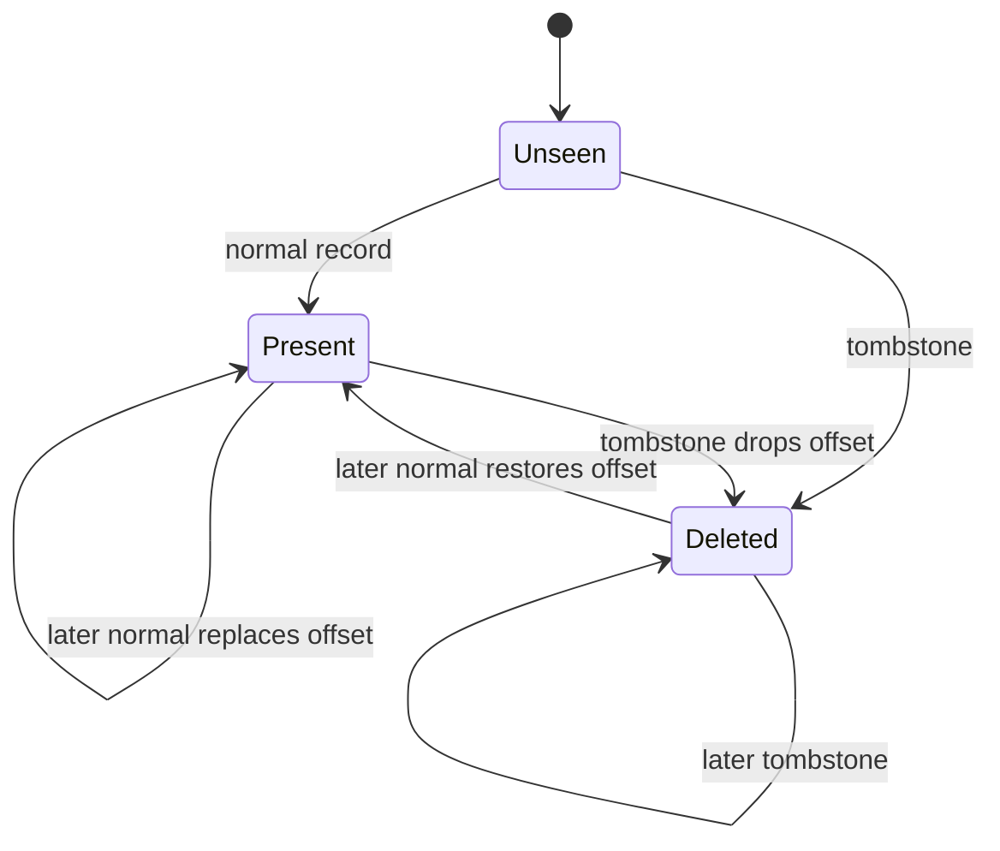

# Indexing

Each open segment owns one in-memory `Index`. Its offsets are meaningful only in that file. The active segment shares the same index between its reader and writer. An older segment builds an index on open and subsequently exposes only reads. The engine supplies recency ordering across files. [Index](../storage/src/main/java/com/ryszardzmija/shaledb/storage/hash/index/Index.java) · [MutableSegment](../storage/src/main/java/com/ryszardzmija/shaledb/storage/hash/segment/model/MutableSegment.java) · [ImmutableSegment](../storage/src/main/java/com/ryszardzmija/shaledb/storage/hash/segment/model/ImmutableSegment.java)

## Local key state

`ByteKey` copies its input, compares bytes with `Arrays.equals` (requiring the same runtime class), and hashes them with `Arrays.hashCode`. `getData()` also returns a copy. Hashing examines the key on each invocation. Distinct caller arrays with identical bytes name the same key, and subsequent mutation of a caller's array cannot break the map's hash buckets. [ByteKey](../storage/src/main/java/com/ryszardzmija/shaledb/storage/hash/index/ByteKey.java)

`HashIndex` uses a `HashMap<ByteKey, Long>` for present keys and a `HashSet<ByteKey>` for deletions. Missing from both means no local record. `markPresent` checks that the offset is nonnegative, puts the offset and removes the deletion marker. `markDeleted` adds the marker and removes the offset. The two container changes form a single logical transition only under serialized access. [HashIndex](../storage/src/main/java/com/ryszardzmija/shaledb/storage/hash/index/HashIndex.java)



The index API exposes separate `isDeleted` and `getKeyOffset` calls. An empty offset covers two states. `SegmentReader.get` checks the marker first, then the offset. A tombstone hit or a local miss requires no record I/O. A present hit reads the whole record and returns its value. Repeated present lookups reread the value. [SegmentReader](../storage/src/main/java/com/ryszardzmija/shaledb/storage/hash/segment/model/SegmentReader.java) · [LookupResult](../storage/src/main/java/com/ryszardzmija/shaledb/storage/hash/segment/model/LookupResult.java)

## Live maintenance and replay

In a live segment, put publishes the writer's append start only after successful append and force. Delete publishes a marker at that same stage and discards its write result. On rebuild, `IndexBuilder` always starts at zero and uses the following loop. There is no saved index, checkpoint or persisted list of keys. [SegmentWriter](../storage/src/main/java/com/ryszardzmija/shaledb/storage/hash/segment/model/SegmentWriter.java) · [IndexBuilder](../storage/src/main/java/com/ryszardzmija/shaledb/storage/hash/index/IndexBuilder.java)

```text
while offset < readChannel.size():
    record = reader.read(offset)          # validates header, payload and CRC
    key = owned copy of record.key
    if record.type == TOMBSTONE: index.markDeleted(key)
    else:                        index.markPresent(key, offset)
    offset = record.nextRecordOffset
```

A scanner must visit even overwritten records to find the next boundary. Mutations later in a file replace that key's earlier index state. Across files, the engine probes the mutable index, then immutable indexes from highest ID to lowest. For example, if file 1 contains a value for K, file 2 deletes K, and file 3 has never seen K, file 3 yields `NotPresent` and file 2 yields `Deleted`. The engine returns absence there. If file 3 later stores a zero-byte value for K, its `Present` result ends the search there instead. The same logic serves a reconstructed index. [HashIndexEngine](../storage/src/main/java/com/ryszardzmija/shaledb/storage/hash/HashIndexEngine.java) · [Storage semantics](storage-semantics.md)

## Consistency boundaries

| Invariant | What enforces it and how it can fail |
| --- | --- |
| A key occupies exactly one local state. | Serial map/set updates maintain exclusivity. An unsynchronized observer can see a transition in progress. A force failure leaves both structures in their pre-call state even if a complete record exists. |
| A present offset names a normal record with the indexed key. | Capture on a single exclusively owned append channel, or replay using the decoded key at its actual start, establishes the relationship. `markPresent` only checks the sign. `SegmentReader` additionally checks the configured upper bound and the record checksum. It never compares the decoded key with the request or checks the decoded type. A misdirected offset to a different valid record can silently return another value or an empty tombstone payload. This failure requires a broken index-to-file association. |
| Indexed records are readable. | An address outside the configured bound throws `IllegalStateException`, even if the index was correctly rebuilt. An address inside the bound but outside the file fails when read. An address in the middle of a record usually fails type, length or checksum validation. [Segment management](segment-management.md) |
| Replay yields either a complete usable segment or a failed open. | `IndexBuilder` returns the new index only after reaching EOF at a record boundary. It wraps I/O failures, incomplete records and configured payload-limit failures as `IndexBuildException` and retains their causes. A corruption exception propagates directly and can bypass channel cleanup. In-memory deleted markers bypass rereading their tombstones, so later on-disk damage may first surface on reopen. [Concurrency and lifecycle](concurrency-and-lifecycle.md) |

## Cost and alternatives

With `S` segments, a lookup can probe all `S` indexes. Hash operations are expected constant time in entry count for well-distributed keys, with hashing/equality work proportional to key length. A full miss performs no record reads. A normal hit adds I/O and CRC work proportional to the winning record's bytes. A serial mutation updates one index, aside from any synchronous rollover rebuild. Startup reads and checksums the total historical bytes and performs one index transition per record. [HashIndex](../storage/src/main/java/com/ryszardzmija/shaledb/storage/hash/index/HashIndex.java) · [RecordReader](../storage/src/main/java/com/ryszardzmija/shaledb/storage/serialization/io/RecordReader.java) · [RolloverHandler](../storage/src/main/java/com/ryszardzmija/shaledb/storage/hash/segment/rollover/RolloverHandler.java)

Retained heap scales with the sum of distinct keys *per file*, including deleted keys, owned key bytes, hash nodes and boxed offsets. A frequently overwritten key may occupy one entry in every segment. Replay also creates transient buffers for old values that will never be returned. Local indexes keep segment loading and disposal independent. The cost grows as history is split into more files.

A global key directory could retain only the current `(segment, offset)` or deletion state per key and reduce the number of probes. Building it requires an explicit replay/merge order. Reclaiming a segment or switching files would then have to coordinate every affected pointer with readers. A single tagged local entry could also consolidate the two current collections while preserving per-segment ownership. Checking identity on a present hit would localize offset errors at the cost of comparing key bytes already in the decoded record. These alternatives address different problems. [Segment lifecycle and reclamation](segment-management.md)
