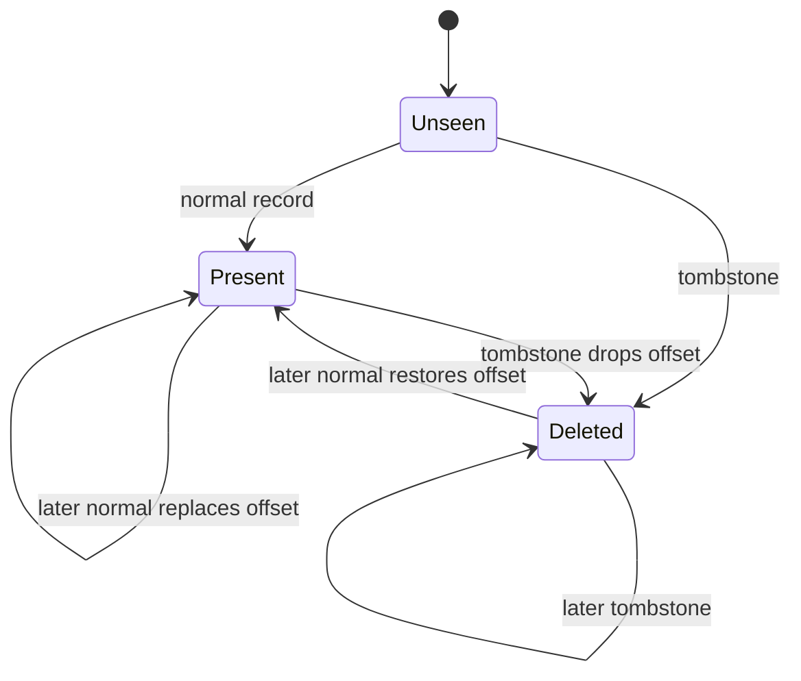

# Indexing

Each open segment owns one in-memory `Index` separate from its physical reader and writer. Its offsets are meaningful only in that file. A historical segment serves lookups from an index rebuilt during startup or inherited at retirement. The engine supplies recency ordering across files. [Index](../storage/src/main/java/com/ryszardzmija/shaledb/storage/hash/index/Index.java) · [MutableSegment](../storage/src/main/java/com/ryszardzmija/shaledb/storage/hash/segment/model/MutableSegment.java) · [ImmutableSegment](../storage/src/main/java/com/ryszardzmija/shaledb/storage/hash/segment/model/ImmutableSegment.java)

## Local key state

`ByteKey` owns a copy of its input and returns a copy from `getData()`. It hashes the complete byte sequence with `Arrays.hashCode` and compares it with `Arrays.equals`. Equal binary keys have equal hashes, and equality resolves collisions between distinct keys. `matches` compares decoded bytes directly with the owned copy. [ByteKey](../storage/src/main/java/com/ryszardzmija/shaledb/storage/hash/index/ByteKey.java)

`HashIndex` uses a `HashMap<ByteKey, Long>` for present keys and a `HashSet<ByteKey>` for deletions. Missing from both means no local record. `markPresent` checks that the offset is nonnegative, puts the offset and removes the deletion marker. `markDeleted` adds the marker and removes the offset. The two container changes form a single logical transition only under serialized access. [HashIndex](../storage/src/main/java/com/ryszardzmija/shaledb/storage/hash/index/HashIndex.java)

Both segment types use `SegmentLookup` to check the deletion marker first. A marker returns `Deleted` without rereading the tombstone. An empty offset after the marker check yields `NotPresent`. For a present entry, `SegmentReader.readValue` takes the physical offset and expected key and returns the value after validating the complete record. [SegmentLookup](../storage/src/main/java/com/ryszardzmija/shaledb/storage/hash/segment/model/SegmentLookup.java) · [SegmentReader](../storage/src/main/java/com/ryszardzmija/shaledb/storage/hash/segment/model/SegmentReader.java)

## Live maintenance and replay

`SegmentWriter` returns the append result only after successful append and force. `MutableSegment` publishes that result's starting offset for a put and a deletion marker for a delete. [SegmentWriter](../storage/src/main/java/com/ryszardzmija/shaledb/storage/hash/segment/model/SegmentWriter.java) · [MutableSegment](../storage/src/main/java/com/ryszardzmija/shaledb/storage/hash/segment/model/MutableSegment.java)

`SegmentScanner` captures the file extent, starts at zero and uses `RecordReader` to validate each record and determine the next offset. It delivers each validated record and its starting offset to `IndexBuilder`, which applies the corresponding offset or deletion marker to a provisional `HashIndex`. Replay follows append order, including overwritten records, so it produces the same local state as applying the same history live. [SegmentScanner](../storage/src/main/java/com/ryszardzmija/shaledb/storage/serialization/io/SegmentScanner.java) · [IndexBuilder](../storage/src/main/java/com/ryszardzmija/shaledb/storage/hash/index/IndexBuilder.java)

The engine probes the mutable index, then immutable indexes from highest ID to lowest. Only `NotPresent` continues the search. A newer `Deleted` result shadows all older versions, and a later reinsertion, including one with a zero-byte value, wins over the deletion. A present record that fails to read or verify terminates lookup and sends the engine to `FAILED`. [HashIndexEngine](../storage/src/main/java/com/ryszardzmija/shaledb/storage/hash/HashIndexEngine.java) · [Fail-stop policy](storage-semantics.md#fail-stop-policy)

## Consistency boundaries

| Invariant | What enforces it and how it can fail |
| --- | --- |
| A key occupies exactly one local state after successful publication. | Serial map/set updates maintain exclusivity. A force failure leaves both structures in their pre-call state even if a complete record exists. A failure while publishing can interrupt either transition, so the failed engine rejects further lookups. |
| A present offset names a normal record with the indexed key. | Append or replay supplies the starting offset. After `RecordReader` validates structure and checksum, `SegmentReader` verifies that the type is `NORMAL` and that the decoded key matches. A wrong key or tombstone yields `INVALID_INDEX_REFERENCE` with the segment path and offset in the cause chain. Recency depends on index publication, replay order and segment order. |
| Indexed reads require a complete record in the actual file. | A negative address or one beyond EOF reports `INVALID_RECORD_LOCATION`. An expected record at EOF reports `INCOMPLETE_RECORD` for the missing header. The reader validates both section extents and the payload budget. An otherwise valid offset remains readable at or beyond the rollover threshold. [Segment management](segment-management.md) |
| Replay yields either a complete usable segment or a failed open. | The scanner checks the final extent before returning. Historical replay requires exact EOF. An eligible incomplete active tail yields the verified prefix and its index. Replay-consumer failure aborts before recovery can truncate the file. The engine uses the index after truncation verification and the startup barriers. Physical scan failures retain their causes through `IndexBuildException`. In-memory deleted markers bypass rereading their tombstones, so later on-disk damage may first surface on reopen. [Durability and recovery](durability-and-recovery.md) |

## Cost and alternatives

With `S` segments, a lookup can probe all `S` indexes. Hash operations are expected constant time in entry count for well-distributed keys, with hashing/equality work proportional to key length. A full miss performs no record reads. A normal hit adds I/O and CRC work proportional to the winning record's bytes. A serial mutation updates one index. Rollover transfers the retiring reader, its channel and its local index to the historical view and starts the successor with an empty index. Startup reads and checksums the total historical bytes and performs one index transition per record. [HashIndex](../storage/src/main/java/com/ryszardzmija/shaledb/storage/hash/index/HashIndex.java) · [RecordReader](../storage/src/main/java/com/ryszardzmija/shaledb/storage/serialization/io/RecordReader.java) · [RolloverHandler](../storage/src/main/java/com/ryszardzmija/shaledb/storage/hash/segment/rollover/RolloverHandler.java)

Retained heap scales with the sum of distinct keys *per file*, including deleted keys, owned key bytes, hash nodes and boxed offsets. A frequently overwritten key may occupy one entry in every segment. Replay also creates transient buffers for old values that will never be returned. Local indexes keep segment loading and disposal independent. The cost grows as history is split into more files.

A global key directory could retain only the current `(segment, offset)` or deletion state per key and reduce the number of probes. Building it requires an explicit replay/merge order. Reclaiming a segment or switching files would then have to coordinate every affected pointer with readers. [Segment lifecycle and reclamation](segment-management.md)
